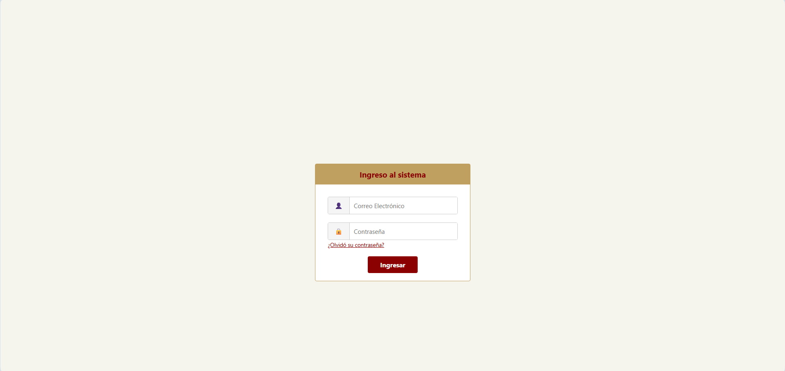

# 🎭 Sistema Web Teatro La Divine

## 📌 Descripción del proyecto

Sistema web en desarrollo para el Teatro La Divine, enfocado en la gestión de inicio de sesión de usuarios, gestión de administradores del Teatro La Divine y futura reserva de entradas.

Actualmente se ha implementado la interfaz de login en el frontend.

Este proyecto se desarrolla en el contexto de la asignatura **Ingeniería de Software**.

---

## 🏗️ Arquitectura del sistema

El sistema sigue una arquitectura **MVC (Model - View - Controller)**:

* **Backend (C# .NET)**

  * Controladores (`Controllers/`)
  * Lógica del sistema
  * Manejo de datos

* **Frontend (React + TypeScript)**

  * Componentes (`.tsx`)
  * Estilos (`.css`)
  * Interfaz de usuario

---

## 📂 Estructura del proyecto

```
DIVINECOMMIT-MAIN/
│
├── backend/
│   ├── Controllers/
│   ├── Program.cs
│   └── appsettings.json
│
├── frontend/
│   ├── public/
│   ├── src/
|   │   ├── components/
│   │   ├── assets/
│   │   ├── styles/
│   │   ├── config/
│   │   ├── App.tsx
│   │   ├── main.tsx
│   │   └── index.css
│   └── package.json
```

---

## 🎨 Estándares de interfaz (UI)

Se utilizan los colores definidos en los requerimientos:

* Primario: `#8B0000`
* Secundario: `#C0A060`
* Crítico: `#D64045`
* Advertencia: `#E6C229`
* Acento: `#F5F0E8`

Uso mediante variables CSS:

```css
:root {
  --primario: #8B0000;
}
```

---

## 💻 Estándares de programación

### 🔹 Nombres

* Variables: `camelCase`
* Funciones: `camelCase`
* Componentes React: `PascalCase`
* Clases (C#): `PascalCase`

### 🔹 Idioma

* El idioma del código será definido por el equipo en etapas posteriores.
* Actualmente no se ha establecido una convención definitiva.

Ejemplo:

```ts
const userEmail = "";
function handleLogin() {}
```

---

### 🔹 Estructura del código

* Separación clara entre carpetas de frontend y backend
* Componentes de React pequeños y reutilizables
* Controladores en backend organizados por funcionalidad

---

### 🔹 Comentarios

* Solo cuando el código no sea evidente
* Explican el **por qué**, no el qué

Ejemplo:

```ts
// Validar formato de correo antes de enviar al backend
```

---

### 🔹 Validaciones (según ERS)

* Email con formato válido
* Campos obligatorios
* Mensajes de error en color `#f56558`

---

## 🔐 Seguridad

* Autenticación por correo y contraseña
* Control de acceso basado en roles:

  * Administrador
  * Cliente

---

## ⚙️ Tecnologías utilizadas

### Frontend

* React
* TypeScript
* CSS

### Backend

* .NET (C#)


---

## 🧪 Casos de prueba (ejemplo)

| Caso           | Entrada                       | Resultado esperado |
| -------------- | ----------------------------- | ------------------ |
| Login válido   | correo + contraseña correctos | Acceso permitido   |
| Email inválido | formato incorrecto            | Error mostrado     |
| Campos vacíos  | sin datos                     | Mensaje de error   |

---

## 📌 Requerimiento implementado (avance)

* ✔ USU-001: Iniciar sesión (frontend en desarrollo)

---

## 📊 Control de versiones

* Uso de Git con commits descriptivos
* Ejemplo:

```
feat: diseño interfaz login
fix: validación de email
```

---

## 👥 Integrantes

* Martín Alejandro Solari Garrido
* Daniel Antonio Días Vargas
* Gianny Alfredo Paredes Araya
* Juan José Gómez Vergara

---

## 📌 Estado del proyecto

🚧 En desarrollo – avance de primera iteración

## 🖼️ Vista actual

<p align="center">
  
</p>

---
## 📎 Notas

El sistema se encuentra en desarrollo y corresponde a la **primera iteración** del proyecto.
